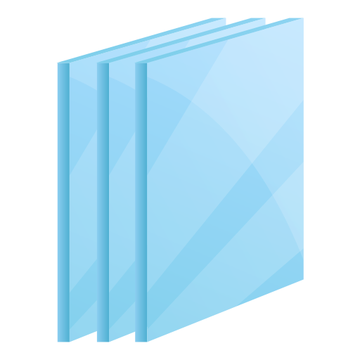
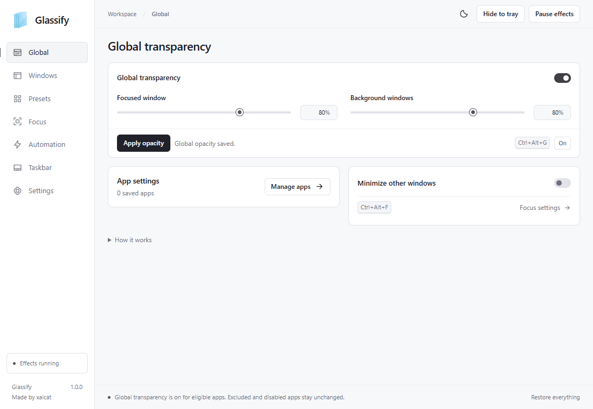
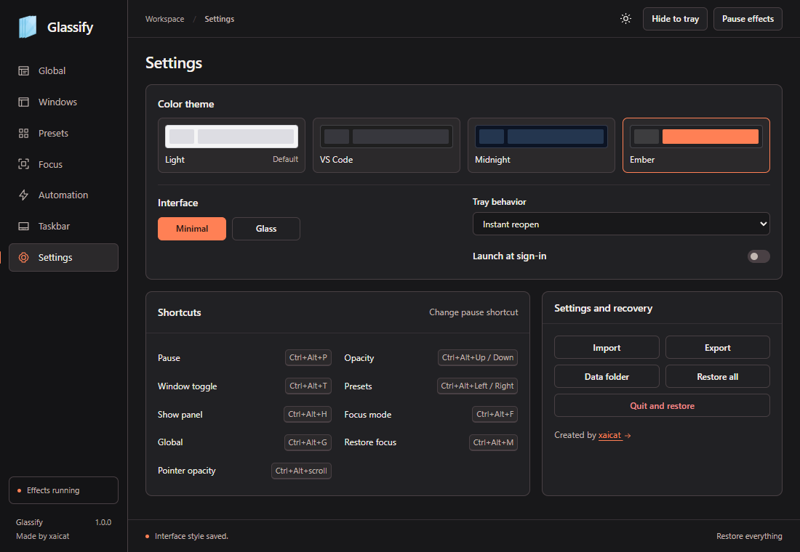

<p align="center"></p>

# Glassify

Control window transparency on Windows. Apply one setting across your desktop or save a different appearance for each app.

**Windows 10 and 11, x64 | Version 1.0.1 | BSD-3-Clause**



## Download

Get the [latest release](https://github.com/xaicat/Glassify/releases/latest).

| Download | Use |
| --- | --- |
| `Glassify-1.0.1-windows-x64-setup.exe` | Install for your Windows account, with Start menu shortcuts and an uninstaller |
| `Glassify-1.0.1-windows-x64.zip` | Extract the complete folder and run `Glassify.exe` |
| `SHA256SUMS.txt` | Verify the downloaded installer or ZIP |

The binaries are unsigned. Compare the SHA-256 checksum before running them. The styled interface needs [Microsoft WebView2 Runtime](https://developer.microsoft.com/en-us/microsoft-edge/webview2/), normally present on Windows 11. Native fallback controls are available if it is missing.

See the [installation guide](docs/INSTALLATION.md) for setup, checksums and removal.

## Get started

1. Open **Global** and enable **Global transparency**.
2. Set **Focused window** and **Background windows**, then click **Apply opacity**. Lower percentages make windows more transparent; 100% is opaque.
3. For individual settings, turn Global off, open **Windows**, select an app, and choose **Save for app**.
4. Minimize or close the panel to keep Glassify running in the tray. Use **Quit and restore** to stop it and restore managed windows.

Global settings do not overwrite saved app rules. Excluded and disabled apps remain unchanged. The default appearance is 95% opacity for focused windows and 85% for background windows.

## Features

- Global transparency for existing and newly opened eligible windows.
- Separate focused and background opacity, saved per app or applied to an individual window.
- Twelve presets, eight tint choices and adjustable tint strength.
- Ctrl+Alt+scroll to adjust the window under the pointer.
- Optional Focus mode that minimizes other windows when your focused app is maximized or full screen.
- Background-only taskbar transparency, keeping taskbar icons and labels solid.
- Light, VS Code-inspired charcoal, Midnight and orange-accented Ember themes.
- Minimal and Glass interface styles, with compact controls and optional help.
- Tray controls, startup preference, import/export, pause and recovery.

Focus mode is **off by default**. Use **Ctrl+Alt+F** to toggle it. Turning it off restores windows Glassify minimized, so multiple maximized windows can remain open together.



## Taskbar transparency

Open **Taskbar**, click **Set up engine**, enable taskbar transparency, choose an opacity, and click **Apply background**. Setup is a one-time download. The background changes while icons and labels remain opaque.

This optional feature uses a separate TranslucentTB engine. It is downloaded only when requested and is not bundled with Glassify. Windows-build compatibility and runtime dependencies are covered in the [taskbar guide](docs/TASKBAR.md).

## Shortcuts

| Shortcut | Action |
| --- | --- |
| Ctrl+Alt+G | Toggle global transparency |
| Ctrl+Alt+F | Toggle Focus mode |
| Ctrl+Alt+P | Pause or resume effects; configurable in Settings |
| Ctrl+Alt+Up / Down | Adjust the focused window's opacity |
| Ctrl+Alt+scroll | Adjust the window under the pointer |
| Ctrl+Alt+T | Toggle effects for the focused window |
| Ctrl+Alt+Left / Right | Switch presets |
| Ctrl+Alt+H | Show or hide the panel |
| Ctrl+Alt+M | Restore windows minimized by the current Focus session |

## Performance and compatibility

Window effects run in a native C++20 engine. The HTML/CSS/JavaScript panel uses WebView2 without a frontend framework or continuous animation loop.

**Instant reopen** keeps the hidden interface ready for quick tray access. **Settings > Tray behavior > Low memory** releases it after hiding, using less resident memory at the cost of reopening time. See [performance](docs/PERFORMANCE.md) for measurements and their limits.

Transparency affects the entire window, including text and controls. Glassify does not replace opaque app interiors with native blur. Secure/system surfaces, inaccessible elevated apps and some rendering paths are excluded. Exclusive full-screen games are unsupported. The Glass interface style applies to Glassify's own panel.

See [compatibility](docs/COMPATIBILITY.md) and the [user guide](docs/USER-GUIDE.md).

## Build and contribute

Build with CMake and a C++20 Windows toolchain. Dependencies are vendored; Node.js is optional development tooling and is not needed to run the app.

```powershell
git clone https://github.com/xaicat/Glassify.git
cd Glassify
cmake --preset msvc
cmake --build --preset msvc
ctest --preset msvc
```

Bug reports, compatibility testing, accessibility improvements and focused pull requests are welcome. Read [CONTRIBUTING.md](CONTRIBUTING.md), [build instructions](docs/BUILDING.md) and [architecture](docs/ARCHITECTURE.md) before making changes.

## License

Created and maintained by [xaicat](https://github.com/xaicat).

Glassify is licensed under [BSD-3-Clause](LICENSE). Reuse must retain the copyright notice, license conditions and disclaimer. Dependencies retain their own licenses; see [NOTICE](NOTICE) and [third-party sources](third_party/README.md).
