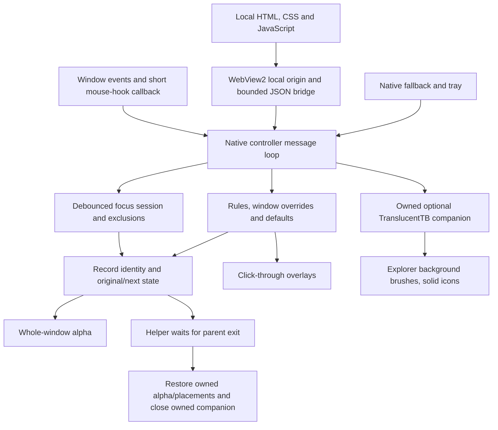

# Glassify architecture

Glassify uses a C++20 resident engine and an local HTML/CSS/JavaScript panel. The optional taskbar engine is a separate TranslucentTB process. These components have different runtime costs and ownership boundaries.

## UI boundary

web contains the editable interface. web_host loads only packaged local content through a virtual HTTPS origin, disables popups and permissions, and restricts navigation. The bridge accepts named actions with native validation. It does not execute arbitrary JavaScript-supplied commands. UI-DEVELOPMENT.md explains styling, lifecycle and tests.

The panel is preloaded and retained hidden by default for instant reopening. An explicit Low memory setting restores lazy creation and closes it after 3.5 seconds hidden. The browser surface stays hidden until the local page has rendered its initial model and acknowledged interfaceReady. Native controls remain available as a fallback and support the established native test workflow. Windows paints exclude child regions, preventing parent repaints from erasing controls. Both interfaces retain keyboard access with solid focus indication.

## Window effects

HWND identity includes PID and process creation time. Ordinary discovery excludes secure, shell, elevated, inaccessible, unresponsive, cloaked and incompatible windows. App appearance is whole-window opacity, including text. Global mode applies shared defaults to existing and newly opened eligible apps, ahead of enabled app appearances without overwriting rules. With Global off, saved rules and the optional automatic fallback apply. Saved exclusions and disabled app rules opt out. Temporary overrides affect one window and take priority over Global. Tints are separate owned, click-through, non-topmost windows.

Recovery records are registered before mutation. Restoration validates identity and an ownership property, preserves unrelated styles, and yields to external appearance changes. The helper receives only explicitly inherited handles. Shared layout version 3 includes companion PID/creation time. Core alpha/placement recovery runs before any bounded companion-startup wait.

## Focus behavior

Foreground and geometry events are debounced by a configurable 150 to 1500 ms settling interval. Focus policy supports maximized/full-screen triggers, same-display or all-display scope, restore-on-switch behavior, and executable exclusions. Menus, owned dialogs and Glassify's panel do not interrupt an existing valid session. Same-display owner transfers preserve the session without restoring every minimized window first. Manual restores remain respected for the session. Show Desktop is not immediately undone by restoration. Only windows actually minimized by Glassify are tracked and restored.

## Taskbar boundary

Whole-taskbar alpha has been removed. The optional TranslucentTB 2026.2 companion replaces Explorer background brushes, preserving icons. It is downloaded from its publisher only after explicit setup, hash-verified, and kept in a separate data folder. An existing independent instance is not modified. A suspended startup registers recovery ownership before execution. See TASKBAR.md for provenance, shell hooks, compatibility and lifecycle.

## Configuration and distribution

Schema 4 stores appearance, automation, focus options, theme and background-only taskbar preferences. Prior schemas are readable; old taskbar fading is disabled during migration. Data defaults to LocalAppData/Glassify, with a legacy-compatible absolute override for tests. Current user data and browser profiles are never shipped.

Portable and installer packages contain the matching controller/helper, WebView2 loader, web assets, setup script, documentation and notices. They do not include the optional TranslucentTB engine, compiler, test executables, user settings or logs. The installer is per-user and deletes only its generated shipped-file list; preferences remain on uninstall.
